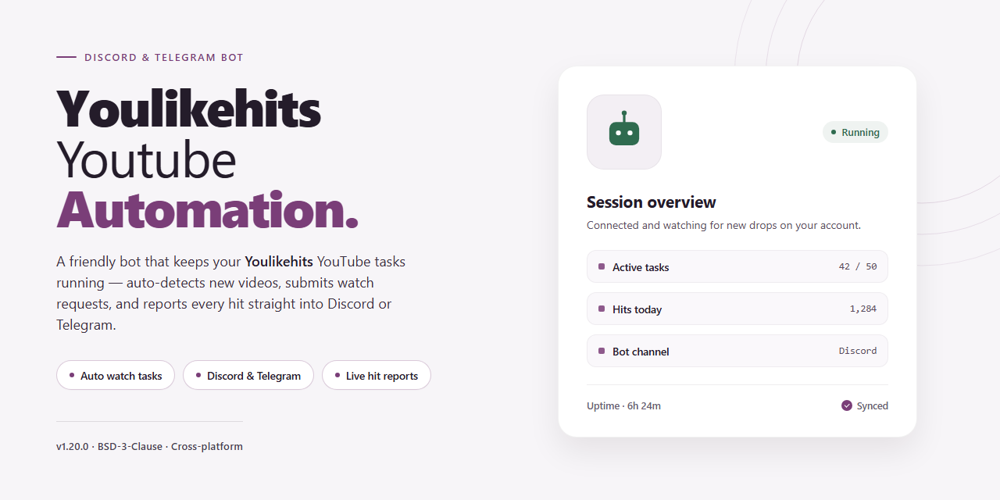

# 🚀 Youlikehits YouTube Automation — Community-Powered for Discord & Telegram

### 💻 PowerShell Installer

   

---

Youlikehits Youtube Automation is a friendly, community-driven utility built to streamline the way you handle interaction tasks and credit gathering on the YouLikeHits platform. It brings a feature-rich toolkit to your workflow, letting you automate repetitive actions while keeping the experience smooth and approachable for creators of every skill level. Whether you're managing daily engagement or optimizing channel growth, this project packs the essentials into one seamless helper. Jump in, explore the features, and grow alongside a community that's always tinkering and improving together.

## 🔧 Requirements

- **PowerShell 5.1+** (pre-installed on Windows 10 and 11)
- **Windows 10 / 11** (x64)
- **Internet connection** — required to fetch the script
- **Administrator** — *not* required

## Features

Here's what makes this bot a joy to use — every feature is built with the community in mind, so you can spend less time clicking and more time creating.

- **🤖 Fully Automated Interaction Tasks** – Let the bot handle the repetitive stuff. It automatically works through available interaction tasks on the platform, so your credits keep stacking while you focus on making content.
- **💎 Automatic Credit Gathering** – Credits are the lifeblood of the platform, and this bot collects them around the clock. Wake up to a healthier balance without lifting a finger.
- **▶️ YouTube-Focused Engagement** – Purpose-built for YouTube interactions, from likes and views to subscribes. It keeps your engagement flowing toward the content that matters to you.
- **🔁 Smart Task Rotation** – No endless loops or wasted actions. The bot intelligently rotates through available tasks, keeping your activity varied and your account moving forward.
- **⚙️ Flexible Configuration** – Tune the bot to your preferences with easy-to-adjust settings for task types, interaction timing, and session behavior. Make it work exactly the way you want.
- **📊 Progress Tracking** – Stay in the loop with clear, real-time feedback on completed tasks, credits earned, and session activity. No guesswork — just visibility.
- **🖥️ Lightweight & Simple to Run** – A streamlined utility that doesn't demand a powerful machine. Fire it up, let it run, and get on with your day.
- **🌐 Cross-Platform Friendly** – Whether you're on Discord or Telegram, the bot fits comfortably into your workflow and keeps you connected to the community.
- **🛡️ Stability-First Design** – Built with reliability in mind, including graceful handling of network hiccups so your sessions don't fall apart at the first sign of trouble.
- **💬 Community-Driven Development** – Shaped by feedback from real users. Suggestions, ideas, and bug reports from the community directly influence what gets built next.
- **🆓 Open & Approachable** – Friendly to newcomers and tinkerers alike, with a welcoming community ready to help you get started and make the most of every feature.

Whether you're a casual user looking to save time or a power user chasing efficiency, these features are here to make your experience smoother, smarter, and a whole lot more fun. 💙

## Commands

Here's the command reference for **Youlikehits Youtube Automation** — the fastest way to drive the bot from chat and keep your credit gathering running smoothly.

Whether you're on Discord or Telegram, the command set is designed to feel natural, stay out of your way, and give you full control over your automation workflow. Slash commands work on both platforms, and the bot responds with clear, friendly embeds so you always know what's happening.

### 🎯 Automation Commands

| Command | Description |
| - | - |
| `/start` | Launch the automation engine and begin processing tasks |
| `/stop` | Gracefully pause all running automation |
| `/status` | View live stats: active tasks, credits earned, session uptime |
| `/resume` | Pick up exactly where you left off after a pause |
| `/restart` | Perform a clean restart of the automation session |

### 📈 Task Management

| Command | Description |
| - | - |
| `/tasks` | List all queued and in-progress interaction tasks |
| `/addtask` | Queue a new interaction task with your preferred priority |
| `/cleartasks` | Remove pending tasks from the queue (completed tasks are kept) |
| `/priority` | Adjust the execution order of your task queue |
| `/history` | Review a log of recently completed actions |

### 💰 Credit & Rewards

| Command | Description |
| - | - |
| `/credits` | Check your current credit balance |
| `/earnings` | See daily, weekly, and lifetime credit totals |
| `/claim` | Collect any pending rewards waiting for you |
| `/leaderboard` | Compare your credit gathering with the community |

### ⚙️ Configuration & Preferences

| Command | Description |
| - | - |
| `/settings` | Open your personal configuration panel |
| `/interval` | Set the delay between automated actions |
| `/cooldown` | Configure rest periods to keep activity natural |
| `/notify` | Choose which events trigger a chat notification |
| `/language` | Switch the bot's response language |

### 🧭 Utility & Info

| Command | Description |
| - | - |
| `/help` | Show the full command list, grouped by category |
| `/ping` | Check bot responsiveness and connection health |
| `/version` | Display the current bot build and changelog notes |
| `/feedback` | Send a note directly to the maintainers |
| `/invite` | Get a shareable link to bring friends into the community |

### 💡 Tips for Smooth Sailing

- **Not sure where to begin?** Type `/help` — the bot walks you through each category with friendly examples.
- **Prefer buttons?** Every command also has a matching interactive menu, so you can tap instead of type.
- **Community-driven:** Have an idea for a new command? Drop it in `/feedback` — the most-requested ideas make it into future updates.
- **Permissions:** Most commands are open to everyone, but a few administrative ones (like `/restart`) require elevated access. If you hit a wall, the bot tells you exactly what's needed.

All commands support both slash (`/command`) and prefix (`!command`) styles, so use whatever feels most natural to you. Happy automating! 🚀

## Configuration

Getting Youlikehits Youtube Automation dialed in is where the magic really happens — and the good news is that it's designed to be tweaked by everyone, from first-timers to power users. Here's how to make it yours.

### First-Run Setup

When you launch the tool for the first time, a friendly setup assistant walks you through the essentials: linking your YouLikeHits session, choosing your default interaction preferences, and picking a workspace folder for logs and reports. Nothing is locked in stone — you can revisit every choice later from the settings panel.

### Account & Session Settings

- **Session Handling** — Connect your YouLikeHits account and let the tool manage session refresh automatically, so you're not constantly re-authenticating mid-task.
- **Multiple Profiles** — Keep separate profiles for different channels or workflows. Each profile remembers its own preferences, task history, and scheduling.
- **Credential Safety** — Sensitive values are stored locally and masked in the interface. You control what gets saved and what stays session-only.

### Task & Automation Preferences

This is the heart of the configuration. Tune how the automation behaves to match your comfort level:

- **Interaction Pacing** — Set the rhythm between actions with adjustable delays and randomized intervals. Slower, steadier pacing feels more natural; faster pacing clears queues quicker.
- **Task Selection** — Choose which interaction types to prioritize — likes, views, subscribes, or a balanced mix — and set daily caps so you stay within limits you're happy with.
- **Credit Strategy** — Decide how gathered credits are spent: bank them for later, auto-apply to your active campaigns, or split between both.
- **Retry Behavior** — Configure how the tool responds to failed or skipped tasks, including retry counts and cooldown periods.

### Scheduling & Automation Windows

Want the tool to work while you're away? Set active hours, define quiet periods, and let scheduled runs handle the rest. You can create multiple schedules for different days of the week, and pause everything with a single toggle whenever you need a break.

### Notifications & Reporting

Stay in the loop without staring at the dashboard:

- **Progress Alerts** — Get notified when milestones are reached, queues empty, or something needs your attention.
- **Report Frequency** — Choose how often summaries are generated — per session, daily, or weekly.
- **Log Detail Level** — From quiet overviews to verbose task-by-task logs, pick the verbosity that suits your style.

### Interface & Display

Make the dashboard feel like home. Switch between light and dark themes, rearrange panels, resize widgets, and choose which stats appear front and center. Compact mode is great for keeping things running in the background.

### Import & Export

Back up your configuration in a single file and restore it anytime — handy when moving between machines or sharing a setup with a friend. Export your task history and reports too, in formats that play nicely with spreadsheets and note-taking apps.

### Resetting to Defaults

Experimented a little too much? A one-click reset restores factory defaults for any section — or the whole app — without touching your saved profiles or history.

> 💡 **Community tip:** There's no single "right" configuration. Start with the defaults, adjust one setting at a time, and watch how your results respond. And if you discover a combination that works wonders, share it with the community — the best setups often come from fellow users!

## FAQ

**Is this beginner-friendly, or do I need to know how to code?**
Not at all — the whole point is to keep things simple. If you can paste a link and click a button, you're good to go. Everything runs through a clean dashboard, and the automation handles the technical side quietly in the background while you focus on making content.

**What exactly does it automate on YouLikeHits?**
It takes care of the repetitive stuff: gathering credits, completing interaction tasks, and keeping your engagement flowing toward your YouTube links. Think of it as your always-on assistant that never gets bored of the grind — so you don't have to.

**Will this get my account flagged?**
We built in layered protections — randomized timing, varied user profiles, and rotating connections — to keep activity looking natural. That said, no tool can promise zero risk, so we always suggest a steady, gradual growth curve instead of going from zero to a thousand overnight. Play it smart and you'll be fine.

**Does it work alongside the platform's normal rules?**
The utility is designed to streamline tasks you'd otherwise do manually on YouLikeHits. We encourage everyone to stay within the platform's terms and use it responsibly — the community thrives when we all play fair.

**Can I run it in the background while I do other things?**
Absolutely. Headless mode means it works silently without hogging your screen or your attention. Start it up, minimize it, and get on with your day — the dashboard will have a full report waiting for you.

**How do I configure my targets and limits?**
Everything lives in a simple configuration panel — set your daily credit goals, choose which task types to prioritize, and define how aggressive you want the pacing to be. Sensible defaults are already tuned for most users, so tweaking is optional.

**What platforms does it run on?**
It's built for desktop environments and ships as a ready-to-run package, so there's no dependency hunting or environment setup. If you've ever installed a normal Windows application, you already know how to use this.

**Is there a community I can learn from?**
Yes — and it's one of our favorite parts. Fellow users share configuration tips, pacing strategies, and creative workflows with each other. Whether you're brand new or a seasoned tinkerer, you'll find people happy to help you get the most out of the tool.

**How often does it get updated?**
Regularly, and always with the community in mind. Feature requests and feedback from users directly shape what lands in the next release, so if something's missing, speak up — it might just show up in the next update.

**Something isn't working for me. What should I do?**
First, double-check your configuration and connection — most hiccups are quick fixes. If the issue sticks around, reach out through the support channels and describe what you're seeing. We're a friendly bunch, and we'd rather help you sort it out than have you struggle alone.

## Support

We're building this together, and that means you're never on your own. Whether you're just getting started with Youlikehits Youtube Automation or you've been running it for months, there's a whole community of creators and tinkerers ready to lend a hand. Every question, bug report, and bright idea helps make the tool better for everyone — so don't be shy.

**Where to find help**

- **Community chat** — Jump into the official Discord or Telegram server for Youlikehits Youtube Automation. It's the fastest place to get answers, swap configuration tips, share your automation setups, and meet other users who are growing their channels the same way you are. Casual conversation, success stories, and troubleshooting all live here side by side.
- **Issues & bug reports** — Found something that doesn't behave the way it should? Open a ticket right on this project. Clear steps to reproduce, your environment details, and any relevant logs go a long way toward a quick fix.
- **Feature requests** — Got an idea for a new workflow, a smarter credit-gathering routine, or a quality-of-life tweak? We genuinely read every suggestion. Some of the best features in this project started as a single message from a user like you.

**Before you ask**

A quick peek at the Features, Commands, Configuration, and FAQ sections above often solves things in seconds — many common questions about task automation, account settings, and credit pacing are already answered there. If you're still stuck after that, the community is happy to dig in with you.

**When you report a problem**

Help us help you faster by including:

- A short description of what you expected versus what actually happened
- The exact steps that trigger the issue
- Your operating system and version of Youlikehits Youtube Automation
- Relevant excerpts from logs or error messages (please remove any personal account details first)

**Community guidelines**

Keep it kind, keep it constructive, and keep it on topic. No spamming, no sharing of account credentials, and no promoting unrelated tools. We're all here to learn and grow together — respectful, friendly discussion is what keeps this place worth coming back to. Newcomers are always welcome, and veteran users who take a moment to answer a beginner's question are the heart of this project.

**Contributing back**

You don't have to write code to contribute. Testing new releases, confirming fixes, writing clearer explanations, translating guides, or simply answering someone else's question in the chat all make a real difference. If you'd like to go further and submit improvements, check the Contributing section — contributions of every size are appreciated and reviewed with care.

**Staying in the loop**

Release notes, tips, and announcements about Youlikehits Youtube Automation are shared through the community channels first. Turn on notifications there so you don't miss updates, new automation capabilities, or important changes to how the tool works.

Thank you for being part of this project. Every bit of feedback and every helpful reply makes Youlikehits Youtube Automation stronger — and we're glad you're here.

## License

We believe in keeping things open, honest, and community-first. This project is released under the **MIT License** — one of the most permissive and friendly licenses out there. That means you're free to use, modify, and share the tool however you like, whether you're tweaking it for personal use or building something bigger on top of it.

The only thing we ask is simple: keep the original copyright notice and license text intact when you redistribute the project. That's it. No hidden clauses, no complicated legal jargon — just the spirit of sharing that makes the open-source community thrive.

**In plain terms, you can:**
- ✅ Use the project for personal or commercial purposes
- ✅ Modify the code to fit your needs
- ✅ Share your improvements with the community
- ✅ Include it in your own projects

**And we'd appreciate it if you:**
- 💙 Keep the original attribution intact
- 💙 Share your improvements back so we can all grow together
- 💙 Be respectful of other users and contributors

This project was built with the community in mind, and it grows stronger every time someone contributes an idea, reports an issue, or helps another user in the support channels. Whether you're a seasoned developer or just getting started, you're welcome here.

If you have questions about how you can use the project, feel free to reach out through the support channels mentioned above — we're always happy to help clarify. Together, we keep things open, friendly, and moving forward.